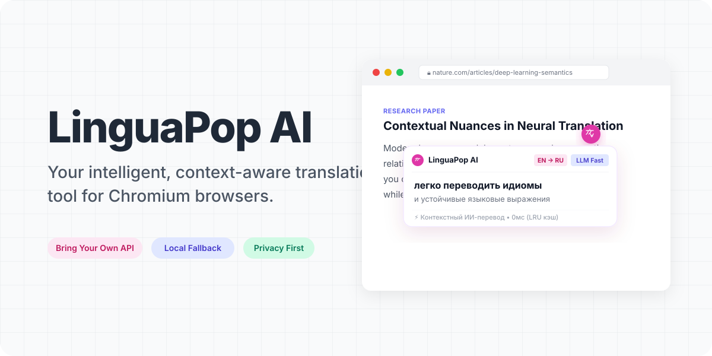

<div align="center">
  <picture>
    <source media="(prefers-color-scheme: dark)" srcset="assets/readme/hero.gif">
    <source media="(prefers-color-scheme: light)" srcset="assets/readme/hero.gif">
    
  </picture>
</div>

<p align="center">
  <a href="README.md"><strong>🇺🇸 Read in English</strong></a> •
  <a href="#-ключевые-возможности"><strong>Возможности</strong></a> •
  <a href="#-быстрая-установка"><strong>Установка</strong></a> •
  <a href="#-настройка-api-ключей"><strong>Настройка</strong></a> •
  <a href="#-горячие-клавиши"><strong>Горячие клавиши</strong></a> •
  <a href="#-приватность-и-безопасность"><strong>Приватность</strong></a>
</p>

<p align="center">
  <a href="https://developer.chrome.com/docs/extensions/mv3/intro/"></a>
  <a href="https://github.com/kkonstantin08/linguapop-ai/releases"></a>
  <a href="#-ключевые-возможности"></a>
  <a href="#-приватность-и-безопасность"></a>
  <a href="#-лицензия"></a>
</p>

---

## 🌟 О проекте

**LinguaPop AI v1.1.6** — современное, быстрое и приватное расширение для Chromium-браузеров (Google Chrome, Яндекс Браузер, Brave, Microsoft Edge, Arc, Vivaldi, Opera).

В отличие от классических переводчиков, использующих устаревшие словарные базы или пересылающих ваш интернет-трафик через сторонние прокси-серверы, LinguaPop AI построен на архитектуре **BYOK (Bring Your Own Key)**. Вы подключаете свои API-ключи ведущих нейросетей, получая перевод кинематографического качества с учетом сленга, идиом и профессионального контекста, мгновенный перевод выделенных фрагментов текста и надежный локальный резервный перевод без задержек.

---

## 🚀 Ключевые возможности

### 🤖 1. Мультимодельная архитектура BYOK (Bring Your Own Key)
Используйте персональные API-ключи без ограничений и абонентской платы третьим лицам:
- **OpenAI**: `gpt-4o`, `gpt-4o-mini`, `o3-mini` — глубокое понимание сложного научного и технического контекста.
- **Anthropic**: `claude-3-7-sonnet`, `claude-3-5-sonnet`, `claude-3-5-haiku` — непревзойденный литературный стиль и органичная подача.
- **Google Gemini**: `gemini-2.5-flash`, `gemini-2.5-pro` — огромный контекст и молниеносный мультиязычный анализ.
- **Groq**: сверхскоростной вывод моделей Llama 3 и Mixtral в реальном времени.
- **Cerebras**: рекордная скорость обработки текста на чипах Wafer-Scale Engine.
- **Mistral AI**: `mistral-large-latest`, `codestral` — идеальная локализация европейских языков.

### ⚡ 2. Smart Fallback: интеллектуальный резервный перевод
Перевод никогда не прервется из-за закончившейся квоты или сетевого сбоя:
- **Chrome Built-in AI**: если в браузере активирован встроенный ИИ (`window.ai` / Gemini Nano через Chrome Translator API), обработка выполняется полностью локально на вашем компьютере.
- **Резерв Google Translate**: при недоступности API выбранного провайдера расширение автоматически переключается на быстрый резервный перевод без всплывающих ошибок и блокировки интерфейса.

### 🎯 3. Мгновенный перевод выделенного текста (Floating Tooltip)
Выделите любое слово, фразу или технический термин на любой веб-странице:
- ⚡ **Плавающая кнопка (FAB)**: Аккуратная розовая иконка LinguaPop мгновенно появляется рядом с выделенным фрагментом.
- 💬 **Контекстная карточка перевода**: Нажмите на кнопку (или сочетание <kbd>Alt</kbd> + <kbd>T</kbd>), чтобы мгновенно получить точный перевод с учетом окружающего контекста, фонетической транскрипции и значений в словаре.
- 🔄 **Автоматическое определение языка**: Расширение на лету распознает язык оригинала и выполняет двусторонний перевод (RU ↔ EN, ES, DE, FR и др.).

### 🌊 4. Waterfall Page Translation (Постраничный потоковый перевод)
Технология аккуратного перевода целых веб-страниц:
- Переводит страницу сверху вниз по мере чтения в потоковом режиме.
- Заменяет текстовые узлы в DOM «на лету», не ломая адаптивную верстку, CSS-стили, интерактивные кнопки и SPA-приложения (React, Vue, Angular).
- Позволяет в один клик переключаться между оригиналом и переводом.

### 🗄️ 5. Локальный LRU-кэш со скоростью отклика 0 мс
- Встроенный механизм Least Recently Used (LRU) сохраняет переведенные фрагменты на устройстве.
- Повторные фразы, заголовки и устойчивые выражения отображаются мгновенно (0 мс задержки).
- Существенно экономит токены API и снижает расходы на вызовы LLM.

---

## 🛠️ Сравнительная таблица провайдеров

| Провайдер | Рекомендуемые модели | Главное преимущество |
| :--- | :--- | :--- |
| **OpenAI** | `gpt-4o`, `gpt-4o-mini`, `o3-mini` | Максимальная точность перевода сложных терминов |
| **Anthropic** | `claude-3-7-sonnet`, `claude-3-5-sonnet` | Богатый словарный запас, естественное звучание |
| **Google Gemini** | `gemini-2.5-flash`, `gemini-2.5-pro` | Высокая скорость работы и большой контекст |
| **Groq** | `llama-3.3-70b-versatile` | Мгновенный отклик при низкой стоимости |
| **Cerebras** | `llama3.1-70b`, `llama3.1-8b` | Рекордная скорость генерации ответов |
| **Mistral AI** | `mistral-large-latest` | Отличная адаптация европейских языковых нюансов |
| **Локальный ИИ** | Chrome Built-in AI (`Gemini Nano`) | Бесплатно, работает оффлайн, абсолютная конфиденциальность |

---

## 📦 Быстрая установка

LinguaPop AI распространяется в виде готового к установке расширения Manifest V3. Установка занимает не более минуты:

### Шаг 1: Клонирование или скачивание репозитория
Склонируйте репозиторий на свой компьютер:
```bash
git clone https://github.com/kkonstantin08/linguapop-ai.git
```
*(Или скачайте ZIP-архив с кодом репозитория и распакуйте его в удобную папку).*

### Шаг 2: Открытие страницы расширений
Откройте браузер на базе Chromium (Chrome, Brave, Яндекс Браузер, Edge, Arc, Opera) и введите в адресную строку:
```text
chrome://extensions
```
*(В Brave: `brave://extensions`, в Edge: `edge://extensions`)*

### Шаг 3: Включение режима разработчика
В правом верхнем углу страницы переведите тумблер **«Режим разработчика»** (Developer mode) в активное положение.

### Шаг 4: Загрузка расширения
1. Нажмите появившуюся в левом верхнем углу кнопку **«Загрузить распакованное расширение»** (Load unpacked).
2. В системном окне выбора файлов укажите папку со склонированным репозиторием:
   ```text
   /путь/к/папке/linguapop-ai
   ```
   *(Папка должна содержать файл `manifest.json`).*

### Шаг 5: Закрепление в панели браузера
Нажмите на иконку пазла (Расширения) на панели инструментов браузера и закрепите **LinguaPop AI** кнопкой-булавкой для быстрого доступа.

---

## ⚙️ Настройка API-ключей

1. **Открытие окна настроек**:
   - Нажмите на иконку LinguaPop AI в панели браузера и перейдите в **Настройки ⚙️**, либо
   - Щелкните правой кнопкой мыши по иконке расширения и выберите пункт **«Параметры»** (Options).
2. **Вкладка провайдеров**:
   - Перейдите в раздел **«Провайдеры»** (Providers).
   - Вставьте ваш API-ключ от выбранного сервиса (OpenAI, Anthropic, Gemini, Groq, Cerebras или Mistral).
   - Выберите предпочтительную модель по умолчанию и желаемый тон перевода.
3. **Направление перевода**:
   - Укажите целевой язык (например, Русский 🇷🇺 или Английский 🇺🇸).
   - LinguaPop AI автоматически определяет исходный язык и переключает направление перевода.

---

## ⌨️ Горячие клавиши

| Сочетание клавиш (Windows / Linux) | Сочетание клавиш (macOS) | Действие | Область применения |
| :--- | :--- | :--- | :--- |
| <kbd>Alt</kbd> + <kbd>T</kbd> | <kbd>⌥ Option</kbd> + <kbd>T</kbd> | **Перевод выделенного текста** | Любой фрагмент на веб-странице |
| <kbd>Ctrl</kbd> + <kbd>Shift</kbd> + <kbd>L</kbd> | <kbd>⌥ Option</kbd> + <kbd>L</kbd> | **Открыть окно расширения** | Быстрый перевод из всплывающего окна |
| <kbd>Esc</kbd> | <kbd>Esc</kbd> | **Закрыть всплывающую подсказку** | Активный попап перевода |

> 💡 *Нужны другие сочетания? Откройте `chrome://extensions/shortcuts` в вашем браузере и переназначьте горячие клавиши по своему вкусу.*

---

## 🔒 Приватность и безопасность

Архитектура LinguaPop AI построена на принципах полной локальной изоляции и нулевой телеметрии:

- 🛡️ **Zero Telemetry (Никакого сбора данных)**: В расширении нет аналитики, трекеров, пикселей отслеживания или сторонних метрик.
- 🔑 **Локальное хранение секретов**: Ваши API-ключи, пользовательские системные промпты и история запросов сохраняются исключительно в изолированном локальном хранилище браузера (`chrome.storage.local`).
- 🌐 **Прямые запросы без посредников**: Расширение не использует сторонние прокси-серверы. Каждый запрос направляется по зашифрованному протоколу HTTPS напрямую из вашего браузера на официальные серверы выбранного вами провайдера (OpenAI, Anthropic, Google и др.).
- 🏢 **Безопасно для работы**: Ваши тексты не используются для скрытого обучения сторонних моделей и защищены пользовательским соглашением вашего личного аккаунта в соответствующем ИИ-сервисе.

---

## 📂 Структура проекта

```text
linguapop-ai/
├── manifest.json              # Конфигурация расширения Chrome Manifest V3
├── background.js              # Сервис-воркер: маршрутизация API и горячие клавиши
├── content.js                 # Контентный скрипт: DOM, выделение текста и карточки перевода
├── chrome-translator-bridge.js# Мост к локальному Chrome Built-in AI (window.ai)
├── popup.html                 # Интерфейс всплывающего окна быстрого перевода
├── options.html               # Страница настроек, выбор моделей и ключей провайдеров
├── options-logs.js            # Диагностические утилиты и логирование
├── options-logs.css           # Таблицы стилей для интерфейса настроек
├── icons/                     # Иконки расширения (16px, 48px, 128px)
└── assets/
    ├── options-rebuilt.*      # Скомпилированные стили и модуль страницы настроек
    ├── popup-rebuilt.*        # Скомпилированные стили и модуль всплывающего окна
    ├── constants-*.js         # Общие константы и вспомогательные функции
    └── readme/                # Графика для документации (hero.gif, hero.svg)
```

---

## 📄 Лицензия

Проект распространяется с открытым исходным кодом под лицензией [MIT License](LICENSE). Вы можете свободно использовать, модифицировать и распространять код в соответствии с условиями лицензии.
